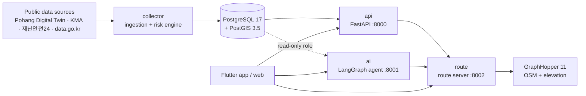
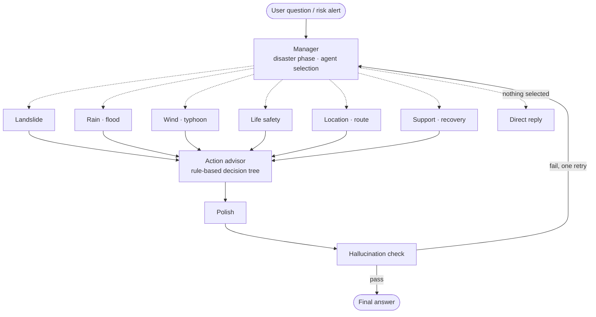

# Guryong Guardian (구룡가디언)

[한국어](README.md) · **English**

**A disaster-response service for Guryongpo, Pohang, South Korea** — one map dashboard for scattered disaster data, plus a personalized AI agent that warns early, explains what to do, and guides people along routes that avoid flooded and landslide-prone areas.

Built by team *구룡포는구룡* for the 2026 Digital Twin Guryongpo AI Hackathon.

- Live service: https://34-64-177-195.nip.io
- Team setup and operations guide (Korean): [docs/team-guide.md](docs/team-guide.md)

## Why

Guryongpo is a fishing town squeezed between the sea and steep hillsides, so heavy rain and typhoons bring floods and landslides at the same time. Many residents are elderly, and disaster information is spread across the Pohang Digital Twin, the Korea Meteorological Administration, 재난안전24, the public data portal and the Life Safety Map. There was no single place to answer "Is the street outside my house dangerous right now?" or "Which way should I evacuate?"

## What it does

- **One dashboard for disaster data.** Water levels, rainfall, wind, weather warnings, disaster text alerts, landslide-prone zones, shelters and medical facilities are collected from the Pohang Digital Twin, the Korea Meteorological Administration, 재난안전24, the public data portal and the Life Safety Map, and drawn on a single map.
- **A risk engine.** Observations are turned into flood and landslide risk areas on five levels (normal, watch, advisory, warning, critical), refreshed every 10 minutes.
- **A personalized AI agent.** Residents ask in plain Korean, by text or voice ("It's raining — is it safe to walk home?"). The answer takes into account where they are, their age, occupation and registered places. The same agent writes proactive warnings when the risk engine raises an alert.
- **Safe evacuation routes.** Walking and driving routes avoid the areas the risk engine currently marks as dangerous. An elderly profile avoids steep slopes. Boats at sea are routed to the nearest port and then over land to a shelter.
- **Tools for local disaster-response volunteers.** A patrol view ranks households by who needs a visit first and builds a multi-stop visit route.
- **Demo mode.** The same screens run on a scripted heavy-rain and strong-wind scenario without touching real data, so the service can be shown on a calm day.

Hazards covered: landslide, heavy rain and flood, strong wind and typhoon, fine dust and UV.

## Architecture



| Service | Role |
| --- | --- |
| `db` | PostgreSQL 17 + PostGIS 3.5. Schema and seed data in `db/init/` |
| `api` | FastAPI server (`/api/v1`): risk, map layers, dashboard, users, alerts, admin |
| `collector` | Scheduled ingestion from the data sources, then the risk engine |
| `ai` | LangGraph multi-agent behind `POST /api/chat`, plus voice endpoints |
| `route` | Route server in front of GraphHopper: hazard avoidance, re-routing, sea routes, multi-stop visit routes |
| `graphhopper` | GraphHopper 11 with foot and car profiles on the Guryongpo road network |
| `caddy` | HTTPS reverse proxy, deployment only |

### The AI agent

A manager agent reads the question, picks only the specialists it needs, and runs them in parallel. Every answer passes a hallucination check before it is sent.



Design choices that matter in a disaster:

- **Numbers come from data, not from the model.** Code collects observations and builds the evidence; the LLM only phrases it. The checker compares every number in the answer against that evidence.
- **Actions are decided by rules.** What to do next comes from a decision tree over official action guides. The LLM never invents action steps.
- **The service keeps answering when the LLM fails.** Classification falls back to keyword routing and writers fall back to templates. If the database is unreachable, the agent says it cannot confirm rather than saying it is safe.
- **The AI cannot write to the database.** It reads through a SELECT-only role and updates a user's profile only through the API, with that user's own token.

Full design: [`ai/docs/agent-design.md`](ai/docs/agent-design.md) (Korean).

### Routing

- Routes are computed by GraphHopper around the flood and landslide areas the risk engine currently marks at advisory level or above. If a route still crosses one, the zone is widened and the request retried.
- Profiles: `adult` takes the fastest way; `elderly` avoids steep roads (1/18 and 1/12 thresholds) and walks slower. Responses include total ascent and descent, maximum slope and length of steps.
- While moving, `POST /api/route/check` returns a new route when the user is more than 30 m off the route or a new risk area appears ahead.
- Sea routes, `POST /api/route/sea`: a grid shortest path that keeps 15 m clear of land and breakwaters to the nearest of 12 ports, then a land route to a shelter.
- Volunteer visit routes, `POST /api/route/visits`: the visiting order for 1–10 stops is solved exactly with Held-Karp dynamic programming. The response carries both the shortest order and a priority order that visits the most at-risk households first.

## Tech stack

| Area | Stack |
| --- | --- |
| Backend | Python 3.12, FastAPI, uvicorn, APScheduler |
| Database | PostgreSQL 17, PostGIS 3.5 |
| AI | LangGraph, Pydantic v2, OpenAI Responses API, OpenAI Realtime over WebRTC for voice (Google Cloud STT/TTS fallback), optional LangSmith tracing |
| Routing | GraphHopper 11 (Java 21), OpenStreetMap, SRTM or NGII elevation data |
| Client | Flutter (one UI for web, Android and iOS), Firebase Auth, Firebase Cloud Messaging |
| Infra | Docker Compose, Caddy, Google Cloud |

## Quick start

You need Docker (OrbStack or Docker Desktop; on Windows, use WSL2 and clone inside it) and git.

```bash
git clone https://github.com/kimking73/guryongpo-safety-agent.git
cd guryongpo-safety-agent
cp .env.example .env
docker compose up -d --build
```

The local defaults in `.env.example` are enough to start every service. The road network for Guryongpo is committed, so there is nothing else to download.

Check that everything is up:

```bash
docker compose ps                       # every service should be (healthy)
curl localhost:8000/api/health          # {"status":"ok","db":"ok", ...}
curl localhost:8001/api/ai/health       # {"status":"ok"}
curl localhost:8002/api/route/health    # {"status":"ok","graphhopper":"ok"}
```

Try it:

```bash
# Current risk at a point
curl "localhost:8000/api/v1/risk?lat=35.99069&lng=129.556057"

# Ask the agent
curl -X POST localhost:8001/api/chat -H 'Content-Type: application/json' \
     -d '{"user_id":"me","question":"비 오는데 걸어서 가도 돼요?"}'

# A walking route that avoids current risk areas
curl -X POST localhost:8002/api/route -H 'Content-Type: application/json' \
     -d '{"origin":{"lat":35.9905,"lon":129.5560},"destination":{"lat":35.9868,"lon":129.5480}}'
```

API docs: http://localhost:8000/api/v1/docs (server), http://localhost:8001/docs (AI), http://localhost:8002/docs (routes).

### Optional keys

Everything starts without keys, with reduced features:

| Key in `.env` | Without it |
| --- | --- |
| `OPENAI_API_KEY` | The agent routes by keywords and answers from templates |
| `KAKAO_REST_KEY` | Destination search only finds saved places, shelters and medical facilities |
| `KMA_API_KEY`, `POHANG_TWIN_API_KEY`, `SAFETY24_API_KEY`, `DATA_GO_KR_API_KEY` | No live data collection from that source |
| `secrets/firebase-admin.json` | No sign-in or push notifications |
| `secrets/gcp-voice.json` or `GCP_VOICE_API_KEY` | The upload-based voice flow returns 503; chat and realtime voice still work |

Never commit `.env` or anything under `secrets/`.

### Run the app

```bash
cd app
flutter run -d chrome                                  # mock data
flutter run -d chrome --dart-define=APP_MODE=remote    # against the local servers
```

See [`app/README.md`](app/README.md) for Android, iOS and Firebase setup.

## Repository layout

| Path | Contents |
| --- | --- |
| `server/` | FastAPI server, data collector, risk engine, OpenAPI spec (`server/spec/openapi.yaml`) |
| `ai/` | LangGraph agent, chat and voice API |
| `route/` | Route server: hazard avoidance, slope rules, sea routes, visit routes |
| `graphhopper/` | GraphHopper image, config, OSM extract and elevation scripts |
| `app/` | Flutter app and web client |
| `db/init/` | Schema and seed data, run once on an empty database |
| `deploy/` | Caddy config and deployment scripts |
| `docs/` | Demo scenario, team guide |

## Tests

```bash
cd ai && .venv/bin/python -m pytest -q       # offline; `-m live` calls the real OpenAI API
cd route && .venv/bin/python -m pytest -q    # uses a fake GraphHopper
cd app && flutter test
```

Each Python service has its own virtual environment: `uv venv .venv && uv pip install -p .venv -e ".[dev]"`.

## Deployment

The services run on a single Google Cloud VM with Docker Compose. Caddy terminates HTTPS and routes `/api/chat`, `/api/voice`, `/api/tts` and `/api/ai` to the AI server, `/api/route` to the route server, the rest of `/api` to the API server, and everything else to the Flutter web build.

```bash
docker compose -f docker-compose.yml up -d    # server mode: no local overrides, database not exposed
./deploy/deploy.sh                            # on the VM: back up DB → pull → reload seeds → rebuild → health check
./deploy/push_web.sh                          # on a dev machine: build the Flutter web app and upload it
```

## Team

Team *구룡포는구룡* — three developers, one lane each.

| Lane | Scope |
| --- | --- |
| A | Server, database, data collection, risk engine (`server/`, `db/`) |
| B | AI, routing, infrastructure (`ai/`, `route/`, `graphhopper/`, deployment) |
| C | Flutter app and web (`app/`) |

## Data sources and attribution

- Road network: © [OpenStreetMap](https://www.openstreetmap.org/copyright) contributors, ODbL
- Elevation: SRTM, or the National Geographic Information Institute (국토지리정보원) digital elevation model
- Disaster and weather data: Pohang Digital Twin, Korea Meteorological Administration, 재난안전24, 공공데이터포털, 생활안전지도
- Font: Pretendard, SIL Open Font License

## Disclaimer

This is a hackathon project. It is not an official warning system. In an emergency, follow the instructions of the authorities and call 119.
