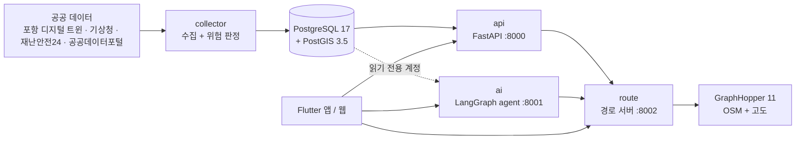
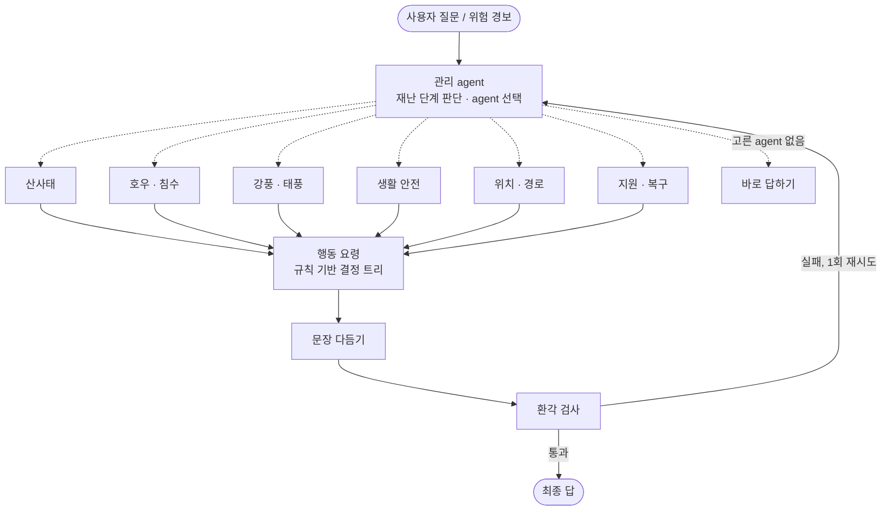

# 구룡가디언 (구룡포 재난 지킴이)

[English](README.md) · **한국어**

2026 디지털 트윈 구룡포 AI Agent 해커톤 출품작(최우수상, 2등)

**포항 구룡포를 위한 재난 대응 서비스** — 흩어진 재난 정보를 지도 하나에 모으고, 사용자 맞춤형 AI agent가 먼저 경고하고,
무엇을 해야 하는지 알려 주고, 침수·산사태 위험 지역을 피하는 길로 안내합니다.

2026 디지털 트윈 구룡포 AI 해커톤, 팀 *구룡포는구룡* 출품작.

- 서비스 주소: https://34-64-177-195.nip.io
- 팀원용 설정·운영 안내: [docs/team-guide.md](docs/team-guide.md)

## 왜 만들었나

구룡포는 바다와 가파른 산비탈 사이에 마을이 있어 호우·태풍 때 침수와 산사태가 함께 옵니다. 주민 중에는 어르신이 많고,
재난 정보는 포항 디지털 트윈, 기상청, 재난안전24, 공공데이터포털, 생활안전지도에 흩어져 있습니다.
"지금 우리 집 앞이 위험한가", "어느 길로 대피해야 하나"를 한 번에 알 수 있는 곳이 없었습니다.

## 주요 기능

- **재난 정보 대시보드.** 수위·강우량·풍속, 기상 특보, 재난문자, 산사태 취약지역, 대피소, 응급의료시설을 모아 지도 하나에 보여 줍니다.
- **위험 판정 엔진.** 관측값으로 침수·산사태 위험 영역을 정상·보통·주의·경보·위험 5단계로 판정해 10분마다 갱신합니다.
- **맞춤형 AI agent.** "비 오는데 걸어서 집에 가도 돼요?"처럼 말이나 글로 물으면, 사용자의 위치·나이·직업·등록 장소(집·직장)를 고려해 답합니다.
  위험 판정 엔진이 경보를 내면 같은 agent가 선제 경고문을 씁니다.
- **안전 대피 경로.** 도보·차량 경로가 지금 위험 지역을 피합니다. 어르신 프로필은 급경사를 피하고, 이동 중 경로를 벗어나거나 새 위험 지역이
  생기면 다시 계산합니다. 바다 위 선박은 가장 가까운 항구를 거쳐 육지 대피소로 안내합니다.
- **지역 방재단 도구.** 누구를 먼저 찾아가야 하는지 가구 순위를 매기고(도움 요청·장애 여부·무응답 순), 여러 집을 도는 방문 경로를 만듭니다.
- **시연 모드.** 실제 데이터를 건드리지 않고 같은 화면을 호우·강풍 시나리오로 보여 줍니다. 날씨가 맑은 날에도 시연할 수 있습니다.

다루는 재난: 산사태, 호우·침수, 강풍·태풍, 미세먼지·자외선.

## 구조



| 서비스 | 역할 |
| --- | --- |
| `db` | PostgreSQL 17 + PostGIS 3.5. 스키마와 기초 데이터는 `db/init/` |
| `api` | FastAPI 서버 (`/api/v1`): 위험도, 지도 레이어, 대시보드, 사용자, 알림, 관리자 |
| `collector` | 데이터 출처에서 정해진 주기로 수집한 뒤 위험 판정 실행 |
| `ai` | `POST /api/chat` 뒤의 LangGraph multi-agent, 음성 API |
| `route` | GraphHopper 앞단 경로 서버: 위험 지역 회피, 재계산, 해상 경로, 방문 경로 |
| `graphhopper` | 구룡포 도로망 위의 GraphHopper 11 (도보·차량) |
| `caddy` | HTTPS 리버스 프록시 (배포 서버에서만) |

### AI agent

관리 agent가 질문을 읽고 필요한 전문 agent만 골라 동시에 실행합니다. 모든 답은 보내기 전에 환각 검사를 거칩니다.



재난 상황이라서 지킨 원칙:

- **숫자는 모델이 아니라 데이터에서.** 관측값 수집과 근거 정리는 코드가 하고, LLM은 문장만 씁니다. 검사 단계가 답의 모든 숫자를 근거와 대조합니다.
- **행동 요령은 규칙으로.** 다음에 할 일은 공식 행동요령 위의 결정 트리가 정합니다. LLM이 행동 요령을 지어내지 않습니다.
- **LLM이 멈춰도 답한다.** 분류는 키워드 분류로, 문장 작성은 템플릿으로 대신합니다. DB를 읽지 못하면 "안전하다"가 아니라 "확인할 수 없다"고 답합니다.
- **AI는 DB에 쓰지 못한다.** SELECT만 되는 계정으로 읽고, 사용자 프로필은 그 사용자의 로그인 토큰으로 API를 거쳐서만 고칩니다.

자세한 설계: [`ai/docs/agent-design.md`](ai/docs/agent-design.md)

### 경로 안내

- 위험 판정 엔진이 지금 낸 침수·산사태 영역(주의 이상)을 피해 GraphHopper로 경로를 계산합니다. 피하지 못한 구역이 있으면 영역을 넓혀 다시 요청합니다.
- 프로필별 규칙: `adult`는 가장 빠른 길, `elderly`는 급경사(1/18·1/12 기준)를 피하고 느린 걸음으로 계산합니다. 응답에 오르막·내리막 합계, 최대 경사, 계단 길이가 담깁니다.
- 이동 중 `POST /api/route/check`: 경로에서 30m 넘게 벗어나거나 남은 길에 새 위험 구역이 생기면 새 경로를 줍니다.
- 해상 경로 `POST /api/route/sea`: 해안선·방파제에서 15m 떨어진 격자 최단 경로로 가장 가까운 항구(12곳)까지, 그 뒤 육지 경로로 대피소까지.
- 방재단 방문 경로 `POST /api/route/visits`: 1~10곳을 도는 순서를 Held-Karp 동적 계획법으로 정확히 풉니다. 최단 순서와 우선순위(위험도 높은 가구 먼저) 순서를 함께 돌려줍니다.

## 기술 스택

| 영역 | 스택 |
| --- | --- |
| 백엔드 | Python 3.12, FastAPI, uvicorn, APScheduler |
| 데이터베이스 | PostgreSQL 17, PostGIS 3.5 |
| AI | LangGraph, Pydantic v2, OpenAI Responses API, 음성은 WebRTC 위의 OpenAI Realtime (대체 경로 Google Cloud STT/TTS), LangSmith 추적(선택) |
| 경로 | GraphHopper 11 (Java 21), OpenStreetMap, SRTM 또는 국토지리정보원 DEM 고도 |
| 클라이언트 | Flutter (웹·Android·iOS 한 화면), Firebase Auth, Firebase Cloud Messaging |
| 인프라 | Docker Compose, Caddy, Google Cloud |

## 빠르게 실행하기

Docker(OrbStack 또는 Docker Desktop. Windows는 WSL2 안에 clone)와 git이 필요합니다.

```bash
git clone https://github.com/kimking73/guryongpo-safety-agent.git
cd guryongpo-safety-agent
cp .env.example .env
docker compose up -d --build
```

`.env.example`의 로컬 기본값만으로 모든 서비스가 뜹니다. 구룡포 도로망 파일이 저장소에 들어 있어 따로 받을 것이 없습니다.

상태 확인:

```bash
docker compose ps                       # 모든 서비스가 (healthy)
curl localhost:8000/api/health          # {"status":"ok","db":"ok", ...}
curl localhost:8001/api/ai/health       # {"status":"ok"}
curl localhost:8002/api/route/health    # {"status":"ok","graphhopper":"ok"}
```

써 보기:

```bash
# 한 지점의 현재 위험도
curl "localhost:8000/api/v1/risk?lat=35.99069&lng=129.556057"

# AI에게 묻기
curl -X POST localhost:8001/api/chat -H 'Content-Type: application/json' \
     -d '{"user_id":"me","question":"비 오는데 걸어서 가도 돼요?"}'

# 지금 위험 지역을 피하는 도보 경로
curl -X POST localhost:8002/api/route -H 'Content-Type: application/json' \
     -d '{"origin":{"lat":35.9905,"lon":129.5560},"destination":{"lat":35.9868,"lon":129.5480}}'
```

API 문서: http://localhost:8000/api/v1/docs (서버), http://localhost:8001/docs (AI), http://localhost:8002/docs (경로)

### 선택 키

키가 없어도 모두 실행되고, 일부 기능만 줄어듭니다.

| `.env` 키 | 없으면 |
| --- | --- |
| `OPENAI_API_KEY` | AI가 키워드로 분류하고 템플릿으로 답함 |
| `KAKAO_REST_KEY` | 목적지 검색이 등록 장소·대피소·의료시설 이름만 찾음 |
| `KMA_API_KEY`, `POHANG_TWIN_API_KEY`, `SAFETY24_API_KEY`, `DATA_GO_KR_API_KEY` | 해당 출처의 실시간 수집 안 됨 |
| `secrets/firebase-admin.json` | 로그인·푸시 알림 안 됨 |
| `secrets/gcp-voice.json` 또는 `GCP_VOICE_API_KEY` | 녹음 업로드 음성 기능만 503. 채팅과 실시간 음성은 동작 |

`.env`와 `secrets/` 안의 파일은 절대 커밋하지 않습니다.

### 앱 실행

```bash
cd app
flutter run -d chrome                                  # 목업 데이터
flutter run -d chrome --dart-define=APP_MODE=remote    # 로컬 서버에 연결
```

Android·iOS·Firebase 설정은 [`app/README.md`](app/README.md)를 보세요.

## 저장소 구조

| 경로 | 내용 |
| --- | --- |
| `server/` | FastAPI 서버, 데이터 수집기, 위험 판정 엔진, OpenAPI 명세(`server/spec/openapi.yaml`) |
| `ai/` | LangGraph agent, 채팅·음성 API |
| `route/` | 경로 서버: 위험 지역 회피, 경사 규칙, 해상 경로, 방문 경로 |
| `graphhopper/` | GraphHopper 이미지·설정, OSM 도로망·고도 스크립트 |
| `app/` | Flutter 앱·웹 |
| `db/init/` | 빈 DB에서 한 번 실행되는 스키마·기초 데이터 |
| `deploy/` | Caddy 설정, 배포 스크립트 |
| `docs/` | 시연 시나리오, 팀원용 안내 |

## 테스트

```bash
cd ai && .venv/bin/python -m pytest -q       # 오프라인. `-m live`는 실제 OpenAI 호출
cd route && .venv/bin/python -m pytest -q    # 가짜 GraphHopper 사용
cd app && flutter test
```

Python 서비스는 각자 가상환경을 씁니다: `uv venv .venv && uv pip install -p .venv -e ".[dev]"`

## 배포

Google Cloud VM 한 대에서 Docker Compose로 돌립니다. Caddy가 HTTPS를 맡고 `/api/chat`·`/api/voice`·`/api/tts`·`/api/ai`는 AI 서버로,
`/api/route`는 경로 서버로, 나머지 `/api`는 API 서버로, 그 외는 Flutter 웹으로 보냅니다.

```bash
docker compose -f docker-compose.yml up -d    # 서버 모드: 로컬 설정 없이, DB 포트 비공개
./deploy/deploy.sh                            # VM에서: DB 백업 → pull → 기초 데이터 재적재 → 재빌드 → 상태 확인
./deploy/push_web.sh                          # 개발 PC에서: Flutter 웹 빌드 후 업로드
```

## 팀

팀 *구룡포는구룡* — 개발자 3명이 세 영역을 나눠 맡았습니다.

| 영역 | 담당 |
| --- | --- |
| A | 서버·DB·데이터 수집·위험 판정 (`server/`, `db/`) |
| B | AI·경로·인프라 (`ai/`, `route/`, `graphhopper/`, 배포) |
| C | Flutter 앱·웹 (`app/`) |

## 데이터 출처와 저작권

- 도로망: © [OpenStreetMap](https://www.openstreetmap.org/copyright) contributors, ODbL
- 고도: SRTM 또는 국토지리정보원 수치표고모델
- 재난·기상 데이터: 포항 디지털 트윈, 기상청, 재난안전24, 공공데이터포털, 생활안전지도
- 글꼴: Pretendard, SIL Open Font License

## 라이선스

코드는 [MIT License](LICENSE)로 공개합니다. 저장소에 함께 들어 있는 데이터와 글꼴은 각자의 라이선스를 따릅니다: OpenStreetMap 도로망은 ODbL, Pretendard 글꼴은 SIL OFL, 공공데이터는 각 기관의 이용 조건.

## 알림

해커톤 출품작이며 공식 재난 경보 시스템이 아닙니다. 위급할 때는 당국의 안내를 따르고 119에 신고하세요.
