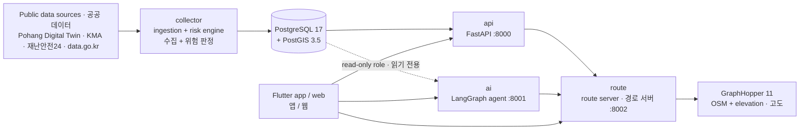
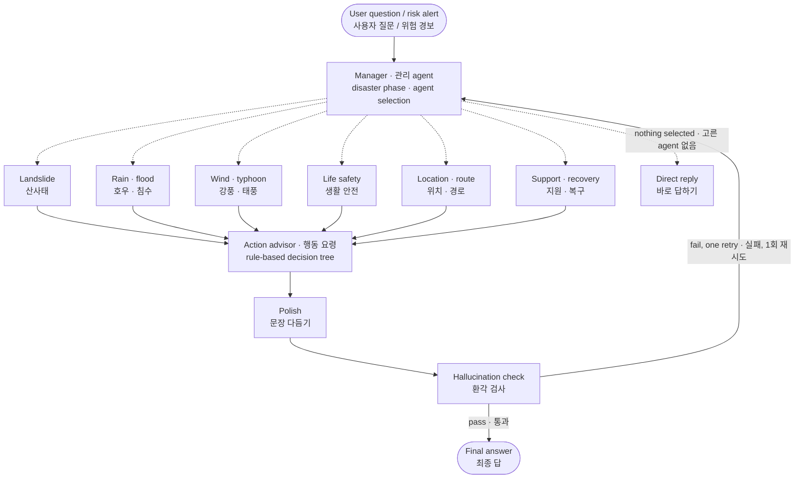

# Guryong Guardian · 구룡가디언

**A disaster-response service for Guryongpo, Pohang, South Korea** — one map dashboard for scattered disaster data, plus a personalized AI agent that warns early, explains what to do, and guides people along routes that avoid flooded and landslide-prone areas.

**포항 구룡포를 위한 재난 대응 서비스** — 흩어진 재난 정보를 지도 하나에 모으고, 사용자 맞춤형 AI agent가 먼저 경고하고, 무엇을 해야 하는지 알려 주고, 침수·산사태 위험 지역을 피하는 길로 안내합니다.

Built by team *구룡포는구룡* for the 2026 Digital Twin Guryongpo AI Hackathon.<br>
2026 디지털 트윈 구룡포 AI 해커톤, 팀 *구룡포는구룡* 출품작.

- Live service · 서비스 주소: https://34-64-177-195.nip.io
- Team setup and operations guide (Korean) · 팀원용 설정·운영 안내: [docs/team-guide.md](docs/team-guide.md)

## Why · 왜 만들었나

Guryongpo is a fishing town squeezed between the sea and steep hillsides, so heavy rain and typhoons bring floods and landslides at the same time. Many residents are elderly, and disaster information is spread across the Pohang Digital Twin, the Korea Meteorological Administration, 재난안전24, the public data portal and the Life Safety Map. There was no single place to answer "Is the street outside my house dangerous right now?" or "Which way should I evacuate?"

구룡포는 바다와 가파른 산비탈 사이에 마을이 있어 호우·태풍 때 침수와 산사태가 함께 옵니다. 주민 중에는 어르신이 많고, 재난 정보는 포항 디지털 트윈, 기상청, 재난안전24, 공공데이터포털, 생활안전지도에 흩어져 있습니다. "지금 우리 집 앞이 위험한가", "어느 길로 대피해야 하나"를 한 번에 알 수 있는 곳이 없었습니다.

## Features · 주요 기능

- **One dashboard for disaster data.** Water levels, rainfall, wind, weather warnings, disaster text alerts, landslide-prone zones, shelters and medical facilities on a single map.<br>
  **재난 정보 대시보드.** 수위·강우량·풍속, 기상 특보, 재난문자, 산사태 취약지역, 대피소, 응급의료시설을 지도 하나에 보여 줍니다.
- **A risk engine.** Observations are turned into flood and landslide risk areas on five levels (normal, watch, advisory, warning, critical), refreshed every 10 minutes.<br>
  **위험 판정 엔진.** 관측값으로 침수·산사태 위험 영역을 정상·보통·주의·경보·위험 5단계로 판정해 10분마다 갱신합니다.
- **A personalized AI agent.** Residents ask in plain Korean, by text or voice ("It's raining — is it safe to walk home?"). The answer takes into account their location, age, occupation and registered places. The same agent writes proactive warnings when the risk engine raises an alert.<br>
  **맞춤형 AI agent.** "비 오는데 걸어서 집에 가도 돼요?"처럼 말이나 글로 물으면, 사용자의 위치·나이·직업·등록 장소(집·직장)를 고려해 답합니다. 위험 판정 엔진이 경보를 내면 같은 agent가 선제 경고문을 씁니다.
- **Safe evacuation routes.** Walking and driving routes avoid current risk areas. An elderly profile avoids steep slopes, and routes are recomputed when the user strays or a new risk appears. Boats at sea are routed to the nearest port and then over land to a shelter.<br>
  **안전 대피 경로.** 도보·차량 경로가 지금 위험 지역을 피합니다. 어르신 프로필은 급경사를 피하고, 경로를 벗어나거나 새 위험 지역이 생기면 다시 계산합니다. 바다 위 선박은 가장 가까운 항구를 거쳐 육지 대피소로 안내합니다.
- **Tools for local disaster-response volunteers.** A patrol view ranks households by who needs a visit first (help requests, disability, no response) and builds a multi-stop visit route.<br>
  **지역 방재단 도구.** 누구를 먼저 찾아가야 하는지 가구 순위를 매기고(도움 요청·장애 여부·무응답 순), 여러 집을 도는 방문 경로를 만듭니다.
- **Demo mode.** The same screens run on a scripted heavy-rain and strong-wind scenario without touching real data, so the service can be shown on a calm day.<br>
  **시연 모드.** 실제 데이터를 건드리지 않고 같은 화면을 호우·강풍 시나리오로 보여 줍니다. 날씨가 맑은 날에도 시연할 수 있습니다.

Hazards covered: landslide, heavy rain and flood, strong wind and typhoon, fine dust and UV.<br>
다루는 재난: 산사태, 호우·침수, 강풍·태풍, 미세먼지·자외선.

## Architecture · 구조



| Service | Role · 역할 |
| --- | --- |
| `db` | PostgreSQL 17 + PostGIS 3.5. Schema and seed data in `db/init/`<br>스키마와 기초 데이터는 `db/init/` |
| `api` | FastAPI server (`/api/v1`): risk, map layers, dashboard, users, alerts, admin<br>FastAPI 서버: 위험도, 지도 레이어, 대시보드, 사용자, 알림, 관리자 |
| `collector` | Scheduled ingestion from the data sources, then the risk engine<br>데이터 출처에서 주기적으로 수집한 뒤 위험 판정 실행 |
| `ai` | LangGraph multi-agent behind `POST /api/chat`, plus voice endpoints<br>`POST /api/chat` 뒤의 LangGraph multi-agent, 음성 API |
| `route` | Route server in front of GraphHopper: hazard avoidance, re-routing, sea routes, visit routes<br>GraphHopper 앞단 경로 서버: 위험 지역 회피, 재계산, 해상 경로, 방문 경로 |
| `graphhopper` | GraphHopper 11 with foot and car profiles on the Guryongpo road network<br>구룡포 도로망 위의 GraphHopper 11 (도보·차량) |
| `caddy` | HTTPS reverse proxy, deployment only<br>HTTPS 리버스 프록시 (배포 서버에서만) |

### AI agent

A manager agent reads the question, picks only the specialists it needs, and runs them in parallel. Every answer passes a hallucination check before it is sent.

관리 agent가 질문을 읽고 필요한 전문 agent만 골라 동시에 실행합니다. 모든 답은 보내기 전에 환각 검사를 거칩니다.



Design choices that matter in a disaster · 재난 상황이라서 지킨 원칙:

- **Numbers come from data, not from the model.** Code collects observations and builds the evidence; the LLM only phrases it. The checker compares every number in the answer against that evidence.<br>
  **숫자는 모델이 아니라 데이터에서.** 관측값 수집과 근거 정리는 코드가 하고, LLM은 문장만 씁니다. 검사 단계가 답의 모든 숫자를 근거와 대조합니다.
- **Actions are decided by rules.** What to do next comes from a decision tree over official action guides. The LLM never invents action steps.<br>
  **행동 요령은 규칙으로.** 다음에 할 일은 공식 행동요령 위의 결정 트리가 정합니다. LLM이 행동 요령을 지어내지 않습니다.
- **The service keeps answering when the LLM fails.** Classification falls back to keyword routing and writers fall back to templates. If the database is unreachable, the agent says it cannot confirm rather than saying it is safe.<br>
  **LLM이 멈춰도 답한다.** 분류는 키워드 분류로, 문장 작성은 템플릿으로 대신합니다. DB를 읽지 못하면 "안전하다"가 아니라 "확인할 수 없다"고 답합니다.
- **The AI cannot write to the database.** It reads through a SELECT-only role and updates a user's profile only through the API, with that user's own token.<br>
  **AI는 DB에 쓰지 못한다.** SELECT만 되는 계정으로 읽고, 사용자 프로필은 그 사용자의 로그인 토큰으로 API를 거쳐서만 고칩니다.

Full design (Korean) · 자세한 설계: [`ai/docs/agent-design.md`](ai/docs/agent-design.md)

### Routing · 경로 안내

- Routes are computed by GraphHopper around the flood and landslide areas the risk engine currently marks at advisory level or above. If a route still crosses one, the zone is widened and the request retried.<br>
  위험 판정 엔진이 지금 낸 침수·산사태 영역(주의 이상)을 피해 GraphHopper로 경로를 계산합니다. 피하지 못한 구역이 있으면 영역을 넓혀 다시 요청합니다.
- Profiles: `adult` takes the fastest way; `elderly` avoids steep roads (1/18 and 1/12 thresholds) and walks slower. Responses include total ascent and descent, maximum slope and length of steps.<br>
  프로필별 규칙: `adult`는 가장 빠른 길, `elderly`는 급경사(1/18·1/12 기준)를 피하고 느린 걸음으로 계산합니다. 응답에 오르막·내리막 합계, 최대 경사, 계단 길이가 담깁니다.
- While moving, `POST /api/route/check` returns a new route when the user is more than 30 m off the route or a new risk area appears ahead.<br>
  이동 중 `POST /api/route/check`: 경로에서 30m 넘게 벗어나거나 남은 길에 새 위험 구역이 생기면 새 경로를 줍니다.
- Sea routes, `POST /api/route/sea`: a grid shortest path that keeps 15 m clear of land and breakwaters to the nearest of 12 ports, then a land route to a shelter.<br>
  해상 경로 `POST /api/route/sea`: 해안선·방파제에서 15m 떨어진 격자 최단 경로로 가장 가까운 항구(12곳)까지, 그 뒤 육지 경로로 대피소까지.
- Volunteer visit routes, `POST /api/route/visits`: the order for 1–10 stops is solved exactly with Held-Karp dynamic programming. The response carries both the shortest order and a priority order that visits the most at-risk households first.<br>
  방재단 방문 경로 `POST /api/route/visits`: 1~10곳을 도는 순서를 Held-Karp 동적 계획법으로 정확히 풉니다. 최단 순서와 우선순위(위험도 높은 가구 먼저) 순서를 함께 돌려줍니다.

## Tech stack · 기술 스택

| Area · 영역 | Stack · 스택 |
| --- | --- |
| Backend · 백엔드 | Python 3.12, FastAPI, uvicorn, APScheduler |
| Database · 데이터베이스 | PostgreSQL 17, PostGIS 3.5 |
| AI | LangGraph, Pydantic v2, OpenAI Responses API, OpenAI Realtime over WebRTC for voice (Google Cloud STT/TTS fallback), optional LangSmith tracing<br>음성은 WebRTC 위의 OpenAI Realtime (대체 경로 Google Cloud STT/TTS), LangSmith 추적(선택) |
| Routing · 경로 | GraphHopper 11 (Java 21), OpenStreetMap, SRTM or NGII (국토지리정보원) elevation data |
| Client · 클라이언트 | Flutter (one UI for web, Android and iOS · 웹·Android·iOS 한 화면), Firebase Auth, Firebase Cloud Messaging |
| Infra · 인프라 | Docker Compose, Caddy, Google Cloud |

## Quick start · 빠르게 실행하기

You need Docker (OrbStack or Docker Desktop; on Windows, use WSL2 and clone inside it) and git.<br>
Docker(OrbStack 또는 Docker Desktop. Windows는 WSL2 안에 clone)와 git이 필요합니다.

```bash
git clone https://github.com/kimking73/guryongpo-safety-agent.git
cd guryongpo-safety-agent
cp .env.example .env
docker compose up -d --build
```

The local defaults in `.env.example` are enough to start every service. The Guryongpo road network is committed, so there is nothing else to download.<br>
`.env.example`의 로컬 기본값만으로 모든 서비스가 뜹니다. 구룡포 도로망 파일이 저장소에 들어 있어 따로 받을 것이 없습니다.

Check that everything is up · 상태 확인:

```bash
docker compose ps                       # every service (healthy) · 모든 서비스가 (healthy)
curl localhost:8000/api/health          # {"status":"ok","db":"ok", ...}
curl localhost:8001/api/ai/health       # {"status":"ok"}
curl localhost:8002/api/route/health    # {"status":"ok","graphhopper":"ok"}
```

Try it · 써 보기:

```bash
# Current risk at a point · 한 지점의 현재 위험도
curl "localhost:8000/api/v1/risk?lat=35.99069&lng=129.556057"

# Ask the agent · AI에게 묻기
curl -X POST localhost:8001/api/chat -H 'Content-Type: application/json' \
     -d '{"user_id":"me","question":"비 오는데 걸어서 가도 돼요?"}'

# A walking route that avoids current risk areas · 지금 위험 지역을 피하는 도보 경로
curl -X POST localhost:8002/api/route -H 'Content-Type: application/json' \
     -d '{"origin":{"lat":35.9905,"lon":129.5560},"destination":{"lat":35.9868,"lon":129.5480}}'
```

API docs · API 문서: http://localhost:8000/api/v1/docs (server · 서버), http://localhost:8001/docs (AI), http://localhost:8002/docs (routes · 경로)

### Optional keys · 선택 키

Everything starts without keys, with reduced features.<br>
키가 없어도 모두 실행되고, 일부 기능만 줄어듭니다.

| Key in `.env` · `.env` 키 | Without it · 없으면 |
| --- | --- |
| `OPENAI_API_KEY` | The agent routes by keywords and answers from templates<br>AI가 키워드로 분류하고 템플릿으로 답함 |
| `KAKAO_REST_KEY` | Destination search only finds saved places, shelters and medical facilities<br>목적지 검색이 등록 장소·대피소·의료시설 이름만 찾음 |
| `KMA_API_KEY`, `POHANG_TWIN_API_KEY`, `SAFETY24_API_KEY`, `DATA_GO_KR_API_KEY` | No live data collection from that source<br>해당 출처의 실시간 수집 안 됨 |
| `secrets/firebase-admin.json` | No sign-in or push notifications<br>로그인·푸시 알림 안 됨 |
| `secrets/gcp-voice.json` or `GCP_VOICE_API_KEY` | The upload-based voice flow returns 503; chat and realtime voice still work<br>녹음 업로드 음성 기능만 503. 채팅과 실시간 음성은 동작 |

Never commit `.env` or anything under `secrets/`.<br>
`.env`와 `secrets/` 안의 파일은 절대 커밋하지 않습니다.

### Run the app · 앱 실행

```bash
cd app
flutter run -d chrome                                  # mock data · 목업 데이터
flutter run -d chrome --dart-define=APP_MODE=remote    # local servers · 로컬 서버에 연결
```

See [`app/README.md`](app/README.md) for Android, iOS and Firebase setup.<br>
Android·iOS·Firebase 설정은 [`app/README.md`](app/README.md)를 보세요.

## Repository layout · 저장소 구조

| Path · 경로 | Contents · 내용 |
| --- | --- |
| `server/` | FastAPI server, data collector, risk engine, OpenAPI spec (`server/spec/openapi.yaml`)<br>FastAPI 서버, 데이터 수집기, 위험 판정 엔진, OpenAPI 명세 |
| `ai/` | LangGraph agent, chat and voice API<br>LangGraph agent, 채팅·음성 API |
| `route/` | Route server: hazard avoidance, slope rules, sea routes, visit routes<br>경로 서버: 위험 지역 회피, 경사 규칙, 해상 경로, 방문 경로 |
| `graphhopper/` | GraphHopper image, config, OSM extract and elevation scripts<br>GraphHopper 이미지·설정, OSM 도로망·고도 스크립트 |
| `app/` | Flutter app and web client<br>Flutter 앱·웹 |
| `db/init/` | Schema and seed data, run once on an empty database<br>빈 DB에서 한 번 실행되는 스키마·기초 데이터 |
| `deploy/` | Caddy config and deployment scripts<br>Caddy 설정, 배포 스크립트 |
| `docs/` | Demo scenario, team guide<br>시연 시나리오, 팀원용 안내 |

## Tests · 테스트

```bash
cd ai && .venv/bin/python -m pytest -q       # offline; `-m live` calls real OpenAI · 오프라인, `-m live`는 실제 OpenAI 호출
cd route && .venv/bin/python -m pytest -q    # fake GraphHopper · 가짜 GraphHopper 사용
cd app && flutter test
```

Each Python service has its own virtual environment · Python 서비스는 각자 가상환경을 씁니다: `uv venv .venv && uv pip install -p .venv -e ".[dev]"`

## Deployment · 배포

The services run on a single Google Cloud VM with Docker Compose. Caddy terminates HTTPS and routes `/api/chat`, `/api/voice`, `/api/tts` and `/api/ai` to the AI server, `/api/route` to the route server, the rest of `/api` to the API server, and everything else to the Flutter web build.

Google Cloud VM 한 대에서 Docker Compose로 돌립니다. Caddy가 HTTPS를 맡고 `/api/chat`·`/api/voice`·`/api/tts`·`/api/ai`는 AI 서버로, `/api/route`는 경로 서버로, 나머지 `/api`는 API 서버로, 그 외는 Flutter 웹으로 보냅니다.

```bash
docker compose -f docker-compose.yml up -d    # server mode, DB not exposed · 서버 모드, DB 포트 비공개
./deploy/deploy.sh                            # on the VM: backup → pull → seeds → rebuild → health · VM에서: 백업 → pull → 기초 데이터 → 재빌드 → 상태 확인
./deploy/push_web.sh                          # on a dev machine: build and upload Flutter web · 개발 PC에서: Flutter 웹 빌드 후 업로드
```

## Team · 팀

Team *구룡포는구룡* — three developers, one lane each.<br>
팀 *구룡포는구룡* — 개발자 3명이 세 영역을 나눠 맡았습니다.

| Lane · 영역 | Scope · 담당 |
| --- | --- |
| A | Server, database, data collection, risk engine (`server/`, `db/`)<br>서버·DB·데이터 수집·위험 판정 |
| B | AI, routing, infrastructure (`ai/`, `route/`, `graphhopper/`, deployment)<br>AI·경로·인프라 |
| C | Flutter app and web (`app/`)<br>Flutter 앱·웹 |

## Data sources and attribution · 데이터 출처와 저작권

- Road network · 도로망: © [OpenStreetMap](https://www.openstreetmap.org/copyright) contributors, ODbL
- Elevation · 고도: SRTM, or the NGII (국토지리정보원) digital elevation model · 수치표고모델
- Disaster and weather data · 재난·기상 데이터: Pohang Digital Twin (포항 디지털 트윈), KMA (기상청), 재난안전24, 공공데이터포털, 생활안전지도
- Font · 글꼴: Pretendard, SIL Open Font License

## Disclaimer · 알림

This is a hackathon project. It is not an official warning system. In an emergency, follow the instructions of the authorities and call 119.<br>
해커톤 출품작이며 공식 재난 경보 시스템이 아닙니다. 위급할 때는 당국의 안내를 따르고 119에 신고하세요.
